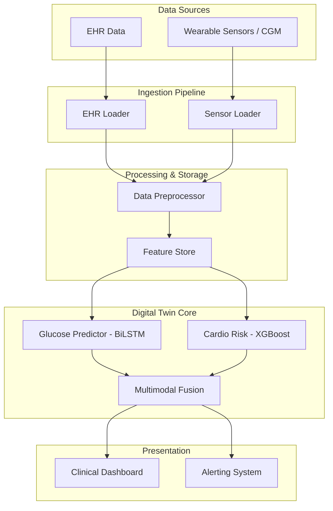
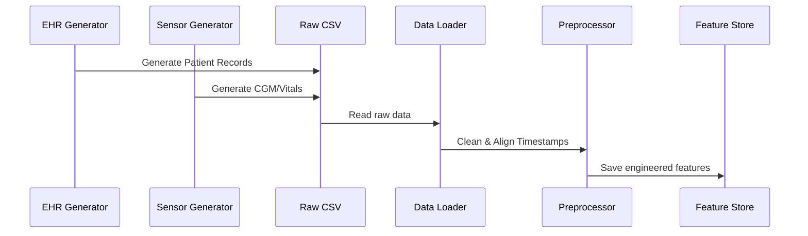
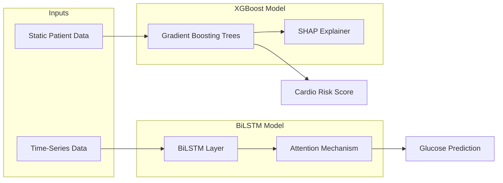
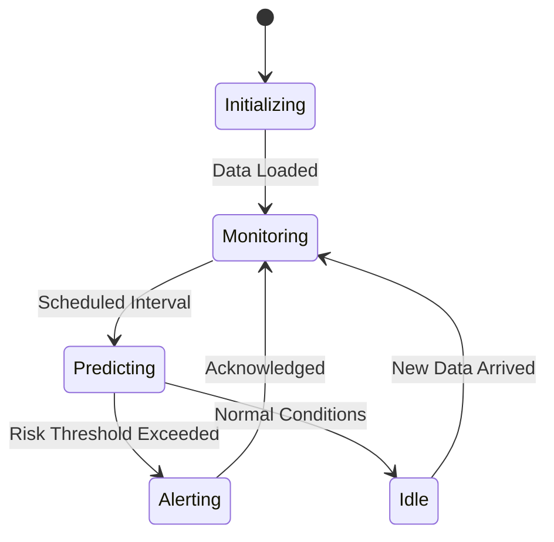

# Digital Twin Architecture Documentation

## 1. System Overview

## 2. Data Pipeline

## 3. Model Architecture

## 4. Digital Twin State Machine

## 5. Dashboard Wireframe Description

- **Header:** Patient demographic info, current Digital Twin status (Active/Idle).
- **Left Panel (Vitals):** Real-time CGM graph, heart rate, and activity levels.
- **Center Panel (Predictions):** Next 2-hour glucose forecast with confidence intervals.
- **Right Panel (Risk):** Cardiovascular risk gauge with top SHAP feature contributors.
- **Bottom Panel (Alerts):** Log of generated alerts and clinical recommendations.

## 6. Technology Stack

| Component | Technology |
| --- | --- |
| Data Processing | Pandas, NumPy, Scikit-learn |
| Deep Learning | PyTorch (BiLSTM + Attention) |
| Machine Learning | XGBoost |
| Interpretability | SHAP |
| Web Application | Streamlit / FastAPI |

## 7. Data Flow Description

The data flow starts with synthetic data generators simulating continuous data streams. The pipeline loads this into the preprocessor to handle missing values and align high-frequency sensor data with static EHR data. Features are extracted and saved to a Feature Store. The Digital Twin core utilizes models tuned on this store to continuously generate near-term (glucose) and long-term (cardio) predictions, driving the interactive dashboard and alerting mechanisms.
