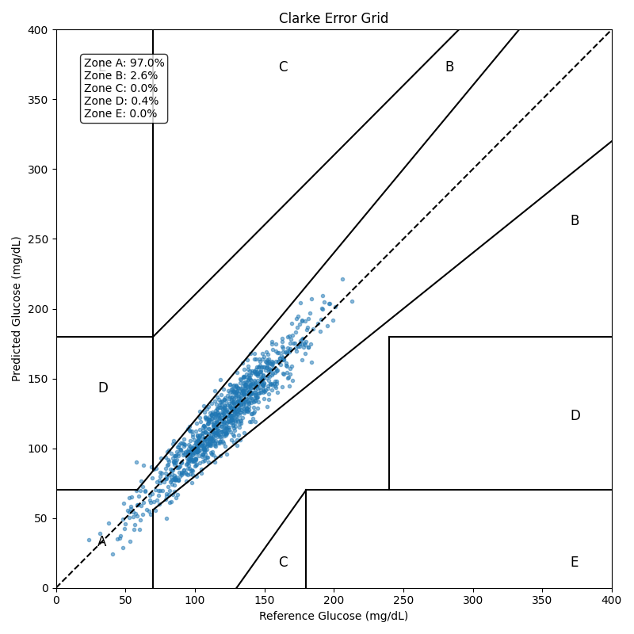
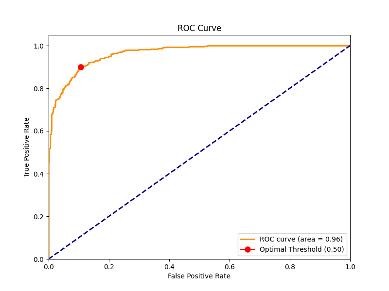
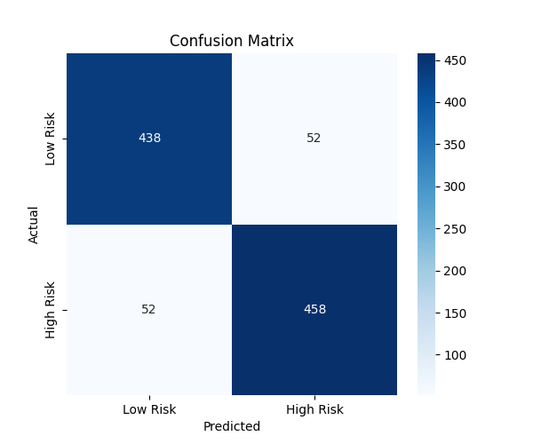

# Digital Twin PoC - Evaluation Report

## 1. Continuous Glucose Prediction (BiLSTM + Attention)
- **RMSE:** 10.31 mg/dL
- **MAE:** 8.36 mg/dL
- **MARD:** 7.47%
- **Clarke Error Grid (A+B):** 99.60%

## 2. Cardiovascular Risk Scoring (XGBoost + SHAP)
- **AUC-ROC:** 0.9648
- **PR-AUC:** 0.9676
- **Sensitivity:** 0.8980
- **Specificity:** 0.8939
- **F1 Score:** 0.8980

